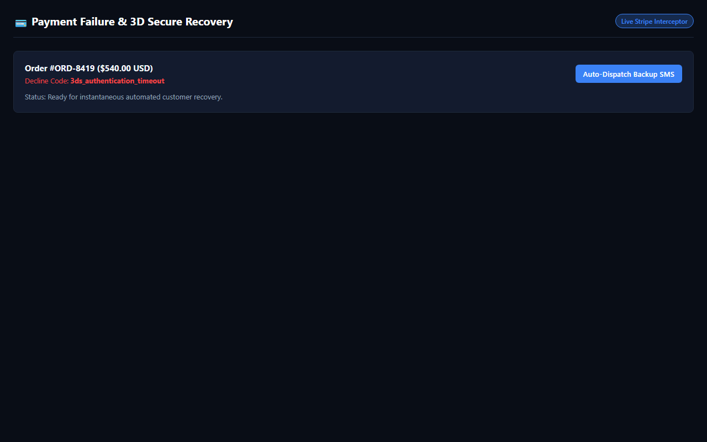

# Payment Failure & 3D Secure Recovery Engine

[](https://gideonbawa-website.netlify.app/simulators/payment-failure-recovery/)
[-success?style=for-the-badge)](test/payment-failure-recovery.test.js)
[](src/index.js)

> **Commercial Value:** $3,500 – $9,500 implementation fee  
> **Primary Buyer:** Founders, Operations Leads, Agency Partners, E-commerce Directors

---

## ⚡ Live Sandbox Preview



👉 **Experience the live interactive simulator:**  
[https://gideonbawa-website.netlify.app/simulators/payment-failure-recovery/](https://gideonbawa-website.netlify.app/simulators/payment-failure-recovery/)

---

## 🎯 Commercial Problem & ROI

Real-time payment decline interceptor that diagnoses decline reason codes and dispatches instant alternative payment links via SMS to rescue $500+ orders.

### Why Existing Solutions Fail
1. **Manual Friction:** Spreadsheets and disconnected messaging threads hide bottlenecks until revenue is destroyed.
2. **Delayed Intervention:** By the time executives realize the problem, clients have churned or money has been refunded.
3. **Lack of Auditability:** No single tamper-proof log tracks commitments and agreements.

---

## 🛠️ Architecture & Under-the-Hood Engineering

- **Zero-Dependency Engine:** High-performance pure Node.js runtime with zero external runtime packages.
- **Deterministic State Modeling:** Clean transitions and audit trails for maximum business reliability.
- **Interactive Dark-Mode HUD:** Live client-facing simulation sandbox for instant stakeholder signoff.

---

## 🧪 Verification & Automated Testing

```bash
npm test
```
